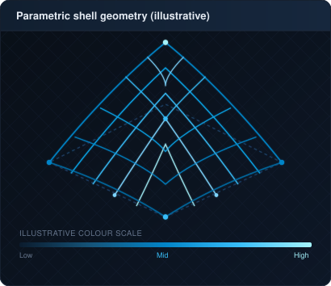
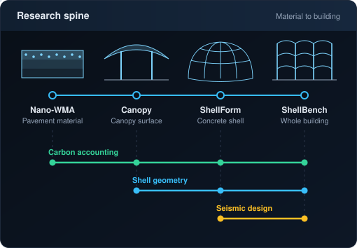

<h3>Contribution Activity</h3>

  

<h3>Research Overview</h3>

<table border="0" cellpadding="0" cellspacing="0">
  <tr>
    <td width="420" valign="top" align="center">
      
    </td>
    <td width="15"></td>
    <td width="510" valign="top" align="center">
      
    </td>
  </tr>
</table>

 

<!-- AUTO:badges -->

<!-- /AUTO:badges -->

---

### Projects

<!-- AUTO:projects -->
* [**ShellBench**](https://github.com/syednafizreja/ShellBench): Measures how much funicular shell floors reduce embodied carbon in seismic RC frame buildings.
* [**ShellForm**](https://github.com/syednafizreja/Shellform): Measures the embodied-carbon cost of making form-found concrete shells earthquake-resistant.
* [**Canopy**](https://github.com/syednafizreja/parametric-canopy-carbon-optimization): Live web prototype linking canopy curvature to structural and embodied-carbon estimates. · [Live demo](https://syednafizreja.github.io/parametric-canopy-carbon-optimization/)
* [**Nano-WMA**](https://github.com/syednafizreja/nano-wma-lca-model): Life-cycle assessment linking nano-modified asphalt durability to carbon emissions.
<!-- /AUTO:projects -->

### Selected Publications

<!-- AUTO:publications -->
1. [Edge AI and IoT for Real-Time Structural Health Monitoring](https://doi.org/10.59324/jaitd.2026.2(5).07), *Journal of Artificial Intelligence and Technological Development*, 2026
2. [Integration of Nano-Additives in Warm Mix Asphalt: Enhancing Moisture Resistance and Long-Term Durability](https://doi.org/10.59324/ejtas.2024.2(6).39), *European Journal of Theoretical and Applied Sciences*, 2024
3. [Application of BIM in Civil Engineering](https://doi.org/10.59324/ejtas.2024.2(4).51), *European Journal of Theoretical and Applied Sciences*, 2024
<!-- /AUTO:publications -->
