  

Two years cycling superelastic NiTi at Denco Manufacturing, after a civil engineering degree at Southwest Petroleum University. The drawing is the order of the work. The alloy enters the frame, the shell takes a bay, and the limit stays visible.

  <a href="https://syednafizreja.github.io/"><kbd>Portfolio</kbd></a>
  &nbsp;
  <a href="https://orcid.org/0009-0002-7162-7890"><kbd>ORCID</kbd></a>
  &nbsp;
  <a href="https://doi.org/10.5281/zenodo.24559613"><kbd>NiTi preprint</kbd></a>
  &nbsp;
  <a href="https://doi.org/10.5281/zenodo.24560903"><kbd>Shell preprint</kbd></a>

  

<table>
  <tr>
    <td width="25%" valign="top"><a href="https://github.com/syednafizreja/diagrid-seismic-opt"><strong>01 Alloy</strong></a> <a href="https://doi.org/10.5281/zenodo.24559613">Preprint</a></td>
    <td width="25%" valign="top"><a href="https://github.com/syednafizreja/stress-line-ribs-shell-buckling"><strong>02 Surface</strong></a> <a href="https://doi.org/10.5281/zenodo.24560903">Preprint</a></td>
    <td width="25%" valign="top"><a href="https://github.com/syednafizreja/ShellBench"><strong>03 Frame</strong></a></td>
    <td width="25%" valign="top"><a href="https://github.com/syednafizreja/ShellForm"><strong>04 Form</strong></a> <a href="https://github.com/syednafizreja/ShellLab">ShellLab</a> · <a href="https://syednafizreja.github.io/ShellLab/">Live</a></td>
  </tr>
</table>

## Still open

- Temperature and a third dimension on the NiTi return map, and a fatigue count that lasts past one earthquake.
- A shell analysis that keeps the dent. The mode-1 imperfection already cuts the thickness gain from 25.74% to 15.03%, and the model is still elastic.
- A frame light enough that the carbon saved on the floor is still there after the earthquake. The median saving is 5.7% on 32 of 33 frames. The devices cost 620.9 kgCO2e.

## Toolbox

<kbd>OpenSeesPy</kbd> &nbsp; <kbd>CalculiX</kbd> &nbsp; <kbd>Python / PyTorch</kbd> &nbsp; <kbd>Gmsh</kbd> &nbsp; <kbd>Three.js</kbd> &nbsp; <kbd>LaTeX</kbd>
