<h3><code>nafiz@github ~ $ ./contributions.sh</code></h3>

 

<h3><code>nafiz@github ~ $ whoami</code></h3>

<table>
<tr>
<td valign="top" width="370"></td>
<td valign="top" width="490"></td>
</tr>
</table>

 

<h3><code>nafiz@github ~ $ cat research-questions.txt</code></h3>

<!-- UPDATE HERE: one question per line, end each line except the last with   -->
How much embodied carbon can thin-shell floors save in code-designed RC frames in seismic zones? 
What is the carbon cost of seismic resilience in form-found concrete shells?

 

<h3><code>nafiz@github ~ $ ls projects/</code></h3>

<!-- UPDATE HERE: copy a line to add a project, newest first, end each line except the last with   -->
<a href="https://github.com/syednafizreja/ShellBench"><b>ShellBench</b></a>: embodied-carbon savings of thin-shell floors in code-designed RC frames in seismic zones 
<a href="https://github.com/syednafizreja/Shellform"><b>Shellform</b></a>: the carbon cost of seismic resilience in form-found concrete shells 
<a href="https://github.com/syednafizreja/parametric-canopy-carbon-optimization"><b>parametric-canopy-carbon-optimization</b></a> 
<a href="https://github.com/syednafizreja/lateral-load-capacity-design-rc-frame"><b>lateral-load-capacity-design-rc-frame</b></a> 
<a href="https://github.com/syednafizreja/nano-wma-pavement-carbon"><b>nano-wma-pavement-carbon</b></a>

 

<h3><code>nafiz@github ~ $ cat publications.txt</code></h3>

<!-- UPDATE HERE: copy a line to add a paper, newest first, end each line except the last with   -->
Hossain et al. (2026). Edge AI and IoT for structural health monitoring. <i>J. Artif. Intell. Technol. Dev.</i> 2(5). 
Raihan et al. (2024). Nano-additives in warm-mix asphalt. <i>Eur. J. Theor. Appl. Sci.</i> 2(6), 451–461. 
Shimky et al. (2024). Building information modelling. <i>Eur. J. Theor. Appl. Sci.</i> 2(4), 595–622.

 

<h3><code>nafiz@github ~ $ contact</code></h3>

<a href="https://orcid.org/0009-0002-7162-7890">ORCID</a> · <a href="https://www.linkedin.com/in/syednafizreja">LinkedIn</a> · <a href="https://www.researchgate.net/profile/Syed-Nafiz-Reja-Hasib-4">ResearchGate</a> · <a href="mailto:syednafiz2811@gmail.com">Email</a>

