  <h3><code>nafiz@formfoundry ~/structures $ ./contributions.sh</code></h3>
  
   
   
  <h3><code>nafiz@formfoundry ~/structures $ whoami</code></h3>
  <table>
    <tr>
      <td valign="top"></td>
      <td valign="top"></td>
    </tr>
  </table>
   
  <a href="https://orcid.org/0009-0002-7162-7890">ORCID</a> · <a href="https://cn.linkedin.com/in/syednafizreja">LinkedIn</a> · <a href="https://www.researchgate.net/profile/Syed-Nafiz-Reja-Hasib-4">ResearchGate</a> · <a href="mailto:syednafiz2811@gmail.com">Email</a>

