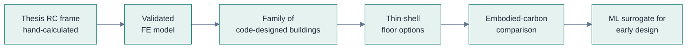

# Syed Nafiz Reja Hasib

### Computational design for low-carbon, resilient structures

*Structural analysis · embodied carbon · machine learning — from my own thesis building to tomorrow's infrastructure*

---

### 🏗️ What I work on

I write open, tested code that connects **structural analysis** with **embodied carbon**, so low-carbon choices can be made at early design, where they cost least and save most. Every model I publish is checked against hand calculations or closed-form solutions before I trust it.

Research spine of <b>ShellBench</b> — in progress, public on completion.

---

### 🔬 Selected projects

| Project | What it does | Stack |
|---|---|---|
| **[parametric-canopy-carbon-optimization](https://github.com/syednafizreja/parametric-canopy-carbon-optimization)** | Interactive thin-shell canopy designer linking geometry, structural response and embodied carbon; evolutionary search for lower-carbon forms | JavaScript · Three.js |
| **[nano-wma-lca-model](https://github.com/syednafizreja/nano-wma-lca-model)** | Screening cradle-to-gate LCA of nano-modified warm-mix asphalt: −5.2% production GWP, −17.5% annualised GWP with a 15% longer service life (assumed) | Python |
| **[pavement-digital-twin](https://github.com/syednafizreja/pavement-digital-twin)** | Prototype that turns lab moisture-durability data (TSR) into a 5-year climate-driven degradation model with BIM-ready export | Python |
| **[chassis-plate-cnc](https://github.com/syednafizreja/chassis-plate-cnc)** | Generates and simulates Fanuc-style G-code for a training-vehicle chassis plate, with gouge and scrap checks | Python · G-code |

---

### 🧭 Research interests

`Parametric structural design` `Embodied-carbon optimisation` `ML surrogate models` `Life-cycle assessment` `Seismic RC design` `Minimum-material shells` `Extreme-environment structures`

---

### 🎓 Background

- **B.Eng. Civil Engineering** — Southwest Petroleum University, China (2019–2023) · Chinese Government Scholarship
  Thesis: full structural design of a 4-storey RC frame in a seismic zone (GB 50010 / GB 50011)
- **Project Engineer** — precision manufacturing of medical-grade instruments in superelastic NiTi and stainless steel (2024–2026)
  Automated quality control · fatigue and defect checks · root-cause analysis
- 🎯 **Next:** research master's and PhD in Europe

<b>📄 Publications (review articles)</b>

 

- Hossain, M.A., Mostofa, M.G., Babu, M.A., **Hasib, S.N.R.**, Arafat, H. (2026). *Edge AI and IoT for real-time structural health monitoring.* J. Artif. Intell. Technol. Dev., 2(5).
- Raihan, P.M.S., **Hasib, S.N.R.**, Phiri, M. (2024). *Integration of nano-additives in warm mix asphalt.* Eur. J. Theor. Appl. Sci., 2(6), 451–461.
- Shimky, S.A., **Hasib, S.N.R.**, et al. (2024). *Application of BIM in civil engineering.* Eur. J. Theor. Appl. Sci., 2(4), 595–622.

---

### 🛠️ Toolbox

---

🌍 Bengali · English · Chinese · learning French — open to research collaborations

