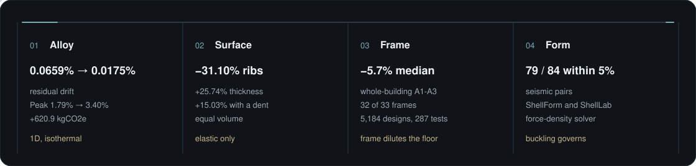

  

I cycled superelastic NiTi at Denco Manufacturing until the parts failed in ways a clean datasheet would skip. The degree before that was civil engineering at Southwest Petroleum University. These repositories are the argument I wrote next: a mechanism, then the number, then the place the mechanism stops.

  <a href="https://syednafizreja.github.io/"><kbd>Portfolio</kbd></a>
  &nbsp;
  <a href="https://orcid.org/0009-0002-7162-7890"><kbd>ORCID</kbd></a>
  &nbsp;
  <a href="https://doi.org/10.5281/zenodo.24559613"><kbd>NiTi preprint</kbd></a>
  &nbsp;
  <a href="https://doi.org/10.5281/zenodo.24560903"><kbd>Shell preprint</kbd></a>

## Research spine

Alloy, then surface, then building, then form. The figure carries the result. The links open the code.

  

<table>
  <tr>
    <td width="25%" valign="top"><a href="https://github.com/syednafizreja/diagrid-seismic-opt"><strong>01 NiTi diagrid</strong></a> <a href="https://doi.org/10.5281/zenodo.24559613">Preprint</a></td>
    <td width="25%" valign="top"><a href="https://github.com/syednafizreja/stress-line-ribs-shell-buckling"><strong>02 Ribs vs thickness</strong></a> <a href="https://doi.org/10.5281/zenodo.24560903">Preprint</a></td>
    <td width="25%" valign="top"><a href="https://github.com/syednafizreja/ShellBench"><strong>03 ShellBench</strong></a> OpenSeesPy and CalculiX</td>
    <td width="25%" valign="top"><a href="https://github.com/syednafizreja/ShellForm"><strong>04 ShellForm</strong></a> <a href="https://github.com/syednafizreja/ShellLab">ShellLab</a> · <a href="https://syednafizreja.github.io/ShellLab/">Live tool</a></td>
  </tr>
</table>

## Still open

- A return map with temperature and a third dimension, plus a fatigue count that is still meaningful after the first earthquake. The diagrid bar is isothermal and one-dimensional.
- A shell that knows it is dented. One mode-1 imperfection already cuts the thickness gain from 25.74% to 15.03%, and the whole comparison is elastic.
- A lighter structural system that does not hand its carbon saving back to the seismic system. The floor saved a median 5.7% on 32 of 33 frames. The NiTi devices cost 620.9 kgCO2e.

## Toolbox

<kbd>OpenSeesPy</kbd> &nbsp; <kbd>CalculiX</kbd> &nbsp; <kbd>Python / PyTorch</kbd> &nbsp; <kbd>Gmsh</kbd> &nbsp; <kbd>Three.js</kbd> &nbsp; <kbd>LaTeX</kbd>
