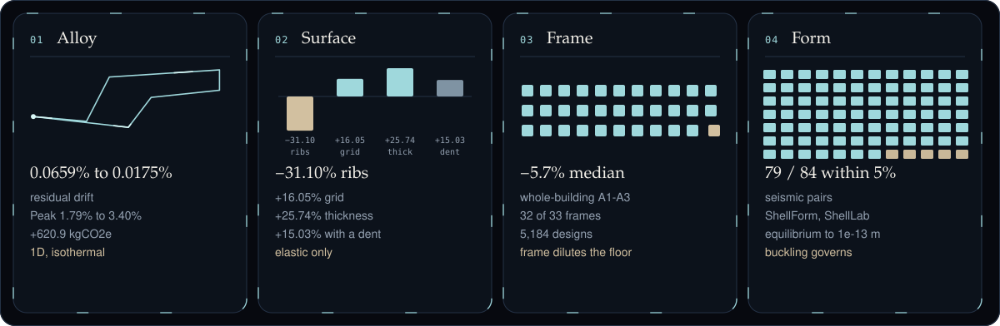

  <a href="https://syednafizreja.github.io/">Portfolio</a>
  &nbsp;·&nbsp;
  <a href="https://orcid.org/0009-0002-7162-7890">ORCID</a>
  &nbsp;·&nbsp;
  <a href="https://doi.org/10.5281/zenodo.24559613">NiTi preprint</a>
  &nbsp;·&nbsp;
  <a href="https://doi.org/10.5281/zenodo.24560903">Shell preprint</a>
  &nbsp;·&nbsp;
  <a href="https://syednafizreja.github.io/ShellLab/">Launch ShellLab</a>

## About

I started by cycling and breaking real superelastic NiTi components at Denco Manufacturing, after a BEng in Civil Engineering at Southwest Petroleum University. The solvers came after that: a place to test where a clean structural idea meets an earthquake, a buckling imperfection, or a carbon count. The question under the repositories is simple. Does the efficient idea still hold once the inconvenient physics is allowed back in?

<table>
  <tr>
    <td width="25%" valign="top"><a href="https://github.com/syednafizreja/diagrid-seismic-opt"><strong>01 Alloy</strong></a> Recentring is not free. Residual drift falls, peak drift and carbon rise. <a href="https://doi.org/10.5281/zenodo.24559613">Preprint</a></td>
    <td width="25%" valign="top"><a href="https://github.com/syednafizreja/stress-line-ribs-shell-buckling"><strong>02 Surface</strong></a> Stress-line ribs look right, then lose 31.10% at equal volume. <a href="https://doi.org/10.5281/zenodo.24560903">Preprint</a></td>
    <td width="25%" valign="top"><a href="https://github.com/syednafizreja/ShellBench"><strong>03 Frame</strong></a> 5,184 shell floors. The frame keeps most of the carbon. <a href="https://doi.org/10.5281/zenodo.24194144">Dataset</a></td>
    <td width="25%" valign="top"><a href="https://github.com/syednafizreja/ShellForm"><strong>04 Form</strong></a> 79 of 84 seismic pairs stay within 5%. Shape is not the governor. <a href="https://github.com/syednafizreja/ShellLab">ShellLab</a> · <a href="https://syednafizreja.github.io/ShellLab/">Live</a></td>
  </tr>
</table>

## Still open

- A return map with temperature, a third dimension, and a fatigue count that survives more than one earthquake.
- A shell analysis that keeps the dent. The mode-1 imperfection already cuts the thickness gain from 25.74% to 15.03%, and the comparison is still elastic.
- A lighter frame that does not hand the carbon saving back. The median whole-building drop is 5.7% on 32 of 33 frames. The NiTi devices cost 620.9 kgCO2e.

## Toolbox

OpenSeesPy · CalculiX · Gmsh · force density

Python · NumPy · SciPy · PyTorch · pytest · Three.js · LaTeX
